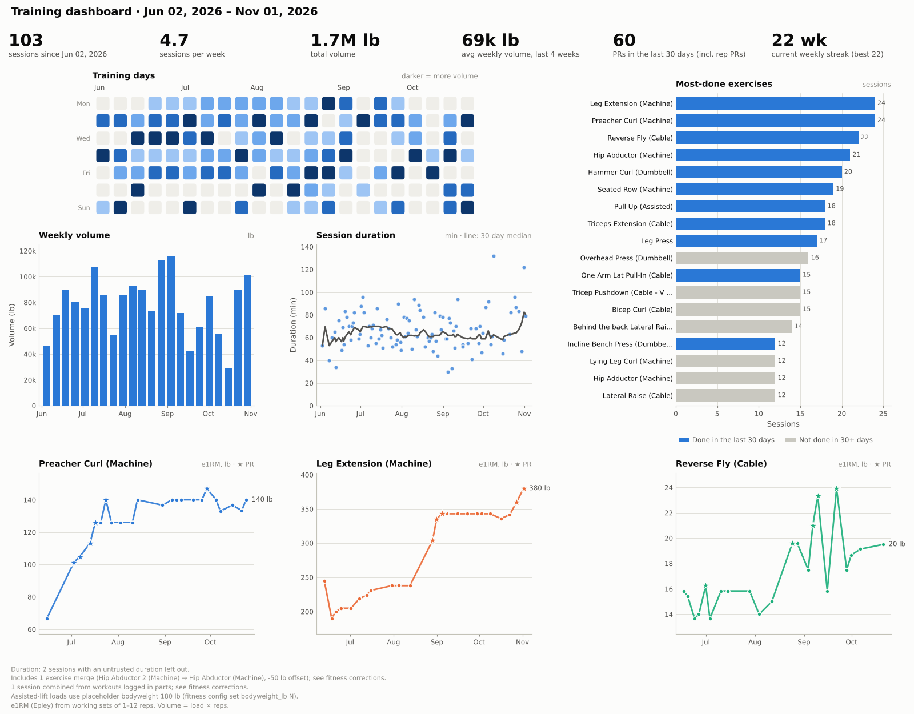
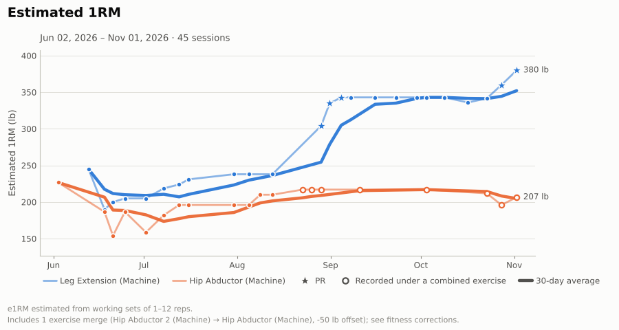
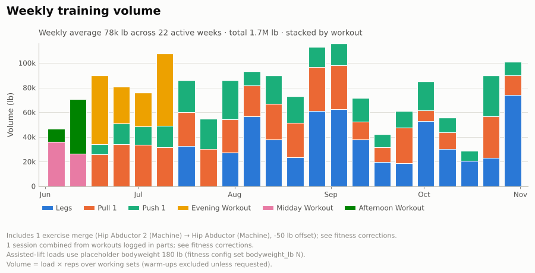
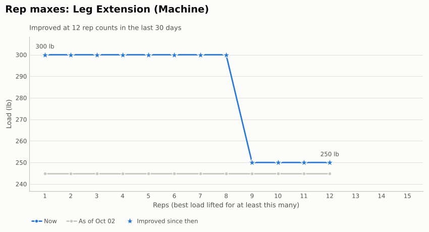
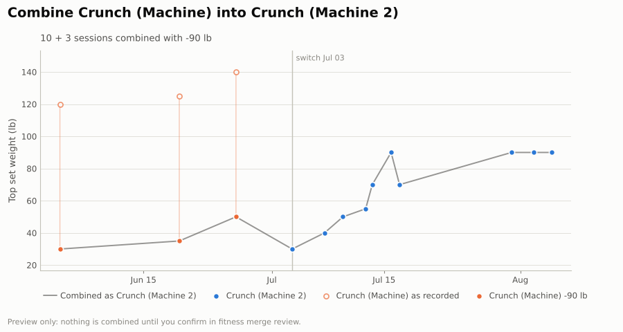
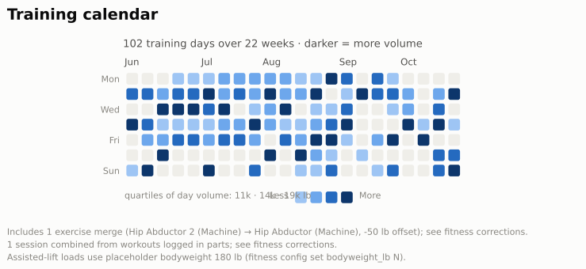

# fitness_aggregator

Turn your Strong app exports into a training history you can trust. `fitness` imports the CSV export into a local SQLite database and cleans it up without ever editing the original: it merges workouts that were split by accident, sets aside runaway timers, helps you fix typos such as weight and reps entered the wrong way round, and combines exercises that are really the same machine, with a weight offset if one gym's machine reads heavier. Every change is logged and can be undone. On top of that you get per-lift history, PRs and rep maxes, weekly stats, hard sets per muscle group, bodyweight from Apple Health, CSV/JSON export, and charts, from the command line or an optional desktop app.



## Quick start

Requires Python 3.11+.

```bash
python3 -m venv .venv
.venv/bin/pip install -e .              # add '.[gui]' for the desktop app
source .venv/bin/activate

fitness import weights_11_3_26.txt      # your Strong export (Settings → Export Data)
fitness check                           # review likely data-entry errors
fitness merge review                    # decide which similar exercises are the same
fitness workouts                        # recent sessions
fitness history "leg extension (machine)"   # one lift, session by session
fitness plot dashboard                  # saves plots/dashboard_<date>.png
```

Run commands from this folder, so the muscle map in `config/exercises.toml` is found. Each export holds your full history, so import the newest one whenever you like. Your corrections and decisions are kept.

## Commands

| Command | What it does |
|---|---|
| `import FILE` | Import a Strong export (replaces stored workouts, keeps your corrections) |
| `workouts` · `show [last\|DATE]` | List sessions; one session set by set |
| `history EXERCISE` | One lift session by session: top set, e1RM, volume, PRs |
| `prs [EXERCISE]` · `prs --recent 30d` | Current bests; rep maxes and PR timeline; recent PRs |
| `stats` | Frequency, streaks, weekly or monthly volume |
| `muscles` | Hard sets per muscle group per week, against a 10–20 target |
| `exercises` | Everything you've logged; `--unmapped` for exercises missing a muscle mapping |
| `check` · `fix` | Review flagged sets; correct set values directly |
| `merge review` · `merge add/undo/list/separate/forget` | Combine similar exercises (optionally with an offset) or keep them separate |
| `corrections` · `corrections revert/restore ID` | The log of every change, and undoing or redoing one |
| `workouts unmerge START` | Split an automatically merged workout back out |
| `plot …` | Charts: progress, volume, calendar, duration, frequency, rep PRs, dashboard, and more (`fitness plot --help`) |
| `import-health FILE` · `bodyweight` | Bodyweight from Apple Health, used for assisted lifts |
| `export` | Sets, sessions, exercises, PRs or corrections as CSV or JSON |
| `config show` · `config set KEY VALUE` | Settings: placeholder bodyweight, merge gap, suspect-duration limit |
| `gui` | The desktop app (optional install) |

Global options `--db PATH` and `--config PATH` go before the command (`fitness --db test.db workouts`). Most read commands take `--raw` to ignore all corrections. `fitness COMMAND --help` lists every option.

## Desktop app

`pip install -e '.[gui]'`, then `fitness gui` (or `fitness-gui`). It uses the same database, settings and charts as the CLI, with tabs for an overview, workouts, exercise history with a progress chart, PRs, every chart (with Save as PNG/SVG/PDF), weekly sets per muscle, bodyweight, the corrections log (revert/restore), and a Review tab for data-entry flags and similar exercises. File → Import works for both Strong and Apple Health exports, previewing the changes first. Shortcuts: Ctrl+I import, F5 refresh, Ctrl+F find an exercise, Ctrl+S save the current chart.


More screenshots: [overview](docs/images/gui_overview.png), [charts](docs/images/gui_charts.png), [muscles](docs/images/gui_muscles.png).

## Charts

| | |
|---|---|
|  |  |
|  |  |



## Documentation

- **[User guide](docs/USER_GUIDE.md)**: the full walkthrough, from exporting from Strong to backups, with real output and an FAQ.
- **[Architecture](docs/ARCHITECTURE.md)**: layers, the corrections model, schema, and how to add a command, chart or importer.
- **[PLAN.md](PLAN.md)**: the design, milestone status, and what's next.

## Development

```bash
.venv/bin/pip install -e '.[dev]'       # pytest and ruff (add gui to run the GUI tests)
.venv/bin/pytest -q
.venv/bin/ruff check src tests
```

CI runs the tests on Python 3.11 and 3.13 and lints the files that are already clean. See [Architecture → Tests, lint and CI](docs/ARCHITECTURE.md#tests-lint-and-ci).

Data lives in `~/.fitness_aggregator/lifts.db` unless you pass `--db` or set `$FITNESS_AGGREGATOR_DB`.
