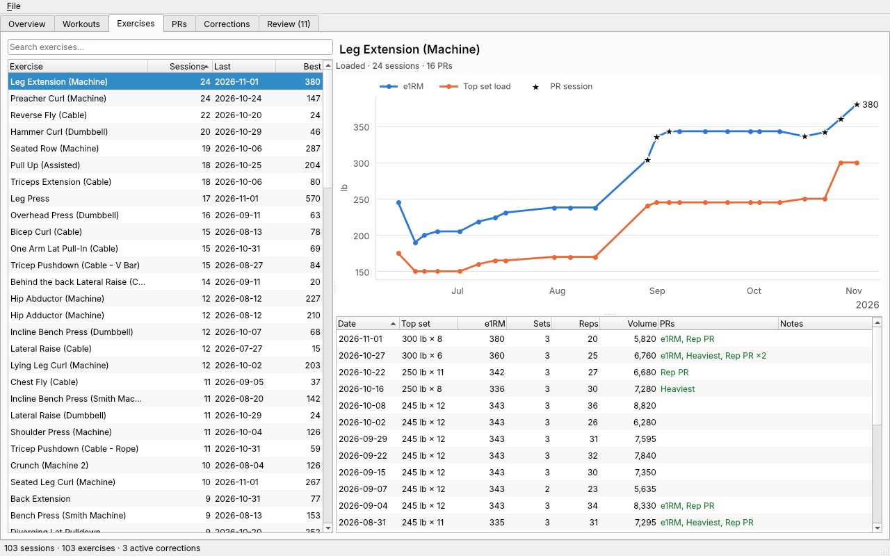

# fitness_aggregator

A command-line tool for importing, analyzing, and graphing weightlifting logs (Strong app CSV exports). See [PLAN.md](PLAN.md) for the design.

## Status

Milestones 1–4 are done: parsing Strong exports, SQLite storage, merging nearby workouts, the corrections log, per-lift history, PRs, training stats, data-entry checks, and combining similar exercises with weight offsets. See [PLAN.md](PLAN.md) §8 for what comes next.

## Usage

```bash
fitness import weights_11_3_26.txt   # each export is your full history; re-import any time
fitness workouts                     # recent sessions (--all, --since 2026-09-01, --raw)
fitness show last                    # one session set by set (or a date: fitness show 2026-06-02)
fitness corrections                  # every change applied on top of your raw data
fitness corrections revert 3         # undo one (fitness corrections restore 3 re-applies it)
fitness workouts unmerge 2026-06-02T14:06

fitness history "bench press (barbell)"   # one lift, session by session (a unique part of the name works)
fitness prs                          # current bests for every exercise
fitness prs squat                    # rep maxes + PR timeline for one lift
fitness prs --recent 30d             # PRs set in the last 30 days
fitness stats                        # frequency, streaks, weekly volume (--by month)
fitness exercises                    # everything you've logged (--sort recent, --search curl)
fitness check                        # review likely data-entry errors: swap, edit, or dismiss
fitness fix 2026-06-04T13:53 "preacher curl" --set 1 --swap-weight-reps

fitness merge review                 # similar exercises: combine (with a suggested offset) or keep separate
fitness merge list                   # what's combined and what's kept separate
fitness merge add "hip abductor 2" --into "hip abductor (machine)" --offset -50
fitness merge undo "hip abductor 2"
fitness config show
fitness config set merge_gap_minutes 45
```

Data is stored in `~/.fitness_aggregator/lifts.db` (override with `--db` or `$FITNESS_AGGREGATOR_DB`). Settings come from `config/settings.toml` when run from this folder (override with `--config`).

## Desktop app (optional)

A PySide6 window over the same database and settings as the CLI: overview stats, workouts set by set, exercise history with a progress chart, PRs, the corrections log (revert/restore), and a Review tab for data-entry flags and similar exercises. File → Import Strong export… imports an export after showing what will change.

```bash
pip install -e '.[gui]'              # adds PySide6 and matplotlib
fitness gui                          # or: fitness-gui
fitness --db other.db gui            # --db/--config work as for every command (fitness-gui --db other.db)
```



More screenshots: [overview](docs/images/gui_overview.png), [review](docs/images/gui_review.png).

## Development setup

Requires Python 3.11+.

```bash
python3 -m venv .venv
.venv/bin/pip install -e '.[dev]'
.venv/bin/pytest
```
