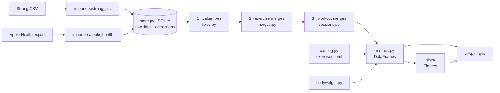

# Architecture

A developer's map of `fitness_aggregator`. For using the tool, see the [user guide](USER_GUIDE.md). For the original design and its reasoning, see [PLAN.md](../PLAN.md).

## The one rule

**Only the CLI modules know about the terminal, and only `gui/` knows about Qt.** Everything else takes and returns plain data: dataclasses (`models.py`, `corrections.Correction`), pandas DataFrames (`metrics.py`), and matplotlib `Figure`s (`plots/`). The CLI and the desktop app call the same `Store` methods and the same metric and plot functions, so a feature written once works in both.

## Layers



| Layer | Modules | Notes |
|---|---|---|
| Models | `models.py` | `Workout`, `ExerciseEntry`, `WorkoutSet`, `SetType`. No I/O |
| Importers | `importers/strong_csv.py`, `importers/apple_health.py` | File → models. Handle every quirk of the export (set-order codes, rest-timer rows, duration strings). Raise `StrongParseError` / `HealthParseError` with line numbers |
| Store | `store.py` | SQLite. Two-step import (`plan_import` → `apply_import`), the corrections table, merge decisions, dismissed flags, bodyweight. `Store.sessions()` returns the corrected view |
| Corrections | `corrections.py`, `sessions.py`, `fixes.py`, `merges.py` | The log, plus one module per correction type. `corrections.reconcile` compares what the automatic rules want with what's stored |
| Review helpers | `outliers.py`, `similarity.py` | Find data-entry flags and similar exercise names, and suggest a weight offset. They **suggest only**: nothing changes until the user acts |
| Metadata | `catalog.py`, `bodyweight.py`, `settings.py` | Exercise kind (loaded / assisted / timed / unloaded) and muscles; `Bodyweight.at(date)`; the settings file |
| Metrics | `metrics.py` | `sets_frame()` builds one tidy row per set. Everything else is a pure function `DataFrame → DataFrame` (history, PR events, current bests, period stats, weekly muscle sets) |
| Plots | `plots/` | `plot_x(df, **opts) -> Figure`, shared look in `plots/style.py`. They never touch pyplot or call `show()` |
| CLI | `cli.py`, `cli_metadata.py`, `cli_plots.py`, `cli_export.py` | Typer and rich. Thin: parse options, call the layers above, format output |
| GUI | `gui/` | PySide6. `controller.py` has no Qt (it loads a snapshot and runs `Store` actions), `window.py` holds the widgets, `charts.py` embeds the same figures |

### How the corrected view is built

Raw workouts and sets are never modified after import. `Store.sessions()` builds the view every time:

1. Load raw workouts (cached until the database changes).
2. Apply active **value fixes** (`fixes.apply_value_fixes`): changed weights/reps/seconds, with the original kept on each set.
3. Apply active **exercise merges** (`merges.apply_exercise_merges`): rename the combined-away exercise, adjust weights by offset or factor, and keep `pre_merge_weight`.
4. Group workouts into **sessions** (`sessions.build_sessions`) using the active `workout_merge` corrections, and drop durations covered by `duration_suspect`.

`--raw` skips steps 2–4 (each workout is its own session). Fixes and merges target raw workout start times and raw exercise names, so the order of steps 2–4 doesn't change which sets they hit.

`metrics.sets_frame(sessions, catalog, bodyweight)` then turns sessions into the DataFrame every metric and plot uses, with effective load for assisted lifts (`bodyweight − assistance`), and with `corrected`, `merged_from` and `pre_merge_weight` columns so output can mark what was changed.

## Corrections model

Every change on top of the raw data is a row in `corrections`:

| Field | Meaning |
|---|---|
| `type` | `workout_merge`, `duration_suspect` (automatic), `value_fix`, `exercise_merge` (user) |
| `source` | `auto` or `user` |
| `target` | JSON: what it applies to, by stable keys (workout start time, exercise name, entry occurrence, set position), never row IDs. `(type, target)` is unique |
| `before` / `after` | JSON values, for display and for checking staleness |
| `reason` | Plain-English sentence shown everywhere |
| `status` | See below |

| Status | Meaning | Becomes |
|---|---|---|
| `active` | Applied | `reverted` (user), `obsolete` (auto rule no longer holds), `stale` (user correction's target changed) |
| `reverted` | User undid it. Kept so the decision survives re-imports | `active` via restore |
| `obsolete` | Automatic correction whose condition no longer holds (setting changed, workout deleted) | `active` if the condition returns |
| `stale` | User correction whose target no longer matches the imported data | `active` automatically if a later import matches again |

**Automatic corrections are recomputed, not edited.** After every import, settings change, revert or restore, `sessions.plan_auto_corrections` works out which automatic corrections *should* exist, and `corrections.reconcile` turns the difference into inserts, updates, reactivations and obsoletions. Reverted keys are passed in, so a reverted merge stays reverted and is treated as absent when deciding later merges. Commands print that difference (`+`, `~`, `-`, `↺`, `!`) so nothing changes silently.

Things that are **not** corrections: outlier flags (a dismissed flag is a row in `dismissed_flags`), keep-separate decisions (`separate_exercises`), and parse steps that change no values, such as attaching rest timers.

## Schema and migrations

`store.py` holds the schema as one `CREATE TABLE IF NOT EXISTS` script and a `SCHEMA_VERSION` (currently 4) in the `meta` table.

| Table | Contents | Since |
|---|---|---|
| `meta` | `schema_version` | 1 |
| `workouts`, `sets` | Raw import. `sets` is keyed by `(workout_started_at, entry_index, position)` and includes `rest_seconds` | 1 |
| `corrections` | The log above | 1 |
| `imports` | One row per import: path, SHA-256, latest workout, counts, summary | 1 |
| `dismissed_flags` | Flag keys dismissed in `check` | 2 |
| `separate_exercises` | Pairs kept separate, stored with `a < b` | 3 |
| `bodyweight` | One row per day, in lb, replaced on each Health import | 4 |

Migrations so far only add tables, so opening an older database runs the script (which creates the missing tables) and bumps the version. A database with a *newer* version is refused. If a future change alters a table, add an explicit step in `Store._init_schema` keyed on the stored version, bump `SCHEMA_VERSION`, and add a test that opens a database at the old version (see `tests/test_store_hardening.py` for the existing database-file tests).

Imports replace raw data rather than append, because every Strong export is a full history. `plan_import` diffs the file against the store (new / edited / removed / unchanged, plus the older-export guard), and `apply_import` writes it in one transaction, then reconciles corrections.

## Extending

### Add a CLI command

1. Write the logic as a function in a non-CLI module, taking and returning plain data: a `Store` method if it reads or writes the database, a `metrics` function if it computes something.
2. Add a Typer command. Small, related groups get their own module that registers on `cli.app` (see `cli_metadata.py` and `cli_export.py`), imported at the bottom of `cli.py`. Use `_state(ctx)` for the store, settings and console, `_analysis(state, raw=…)` for the standard sets DataFrame, and `_fail(console, msg)` for user errors. Accept `--raw` wherever corrections apply.
3. Test it through `typer.testing.CliRunner` with `--db` and `--config` pointing into `tmp_path` (see `tests/test_cli_plots.py`). `tests/helpers.py` builds small Strong exports inline.
4. If the GUI should have it too, add a method on `gui/controller.py` (which has no Qt) that calls the same function, then a widget in `gui/window.py`. GUI tests live in `tests/test_gui.py`.

### Add a chart

1. Create `plots/<name>.py` with `plot_<name>(df, ..., footnotes=None) -> Figure`. Use `style.new_figure`, `style.set_titles` and `style.add_footnote` so it matches the others, and decorate with `@use_style`. If the dashboard should reuse it, also provide `draw_<name>(ax, df, ...)`.
2. Export it from `plots/__init__.py`.
3. Add a command on `plot_app` in `cli_plots.py`. Use `_setup(ctx, raw)`, build notes with `footnotes(a, df)` (corrections, merges, placeholder bodyweight), and finish with `_output(console, fig, name, out, show)` so `--out` and `--show` behave like every other chart.
4. Test the function on a small frame (`tests/test_plots.py`) and the command (`tests/test_cli_plots.py`). Tests use the Agg backend, so no display is needed.

### Add an importer

1. Add `importers/<app>.py` returning the same `ParseResult` (a list of `Workout`s plus `ParseStats` and warnings) as `strong_csv.py`. Map the app's set types onto `SetType`, convert to lb, and attach rest times to sets.
2. Raise a parse error with a line number for malformed input, and add warnings for oddities you can survive.
3. Wire it into `fitness import`: detect the format from the header or take an option. The store doesn't care where workouts came from, but start times are the workouts' identity, so two importers' data shouldn't be mixed in one database without deciding how they key.
4. Add fixture files under `tests/fixtures/` covering each quirk.

Bodyweight sources follow the Apple Health pattern: produce one value per day and go through `Store.plan_bodyweight_import` / `apply_bodyweight_import`.

## Tests, lint and CI

```bash
uv venv .venv && uv pip install --python .venv/bin/python -e '.[dev]'   # or python -m venv + pip
.venv/bin/pytest -q                  # whole suite, about half a minute
.venv/bin/pytest tests/test_store.py -q
.venv/bin/ruff check src tests
```

- `tests/test_real_export.py` and some others run against the real export `weights_11_3_26.txt` in the repo root (104 workouts, 1,962 sets, 103 sessions after one merge).
- `tests/test_gui.py` runs the app offscreen and **skips itself when PySide6 isn't installed**. Install `.[gui]` to run it locally.

CI (`.github/workflows/tests.yml`) runs on every push and pull request:

1. `pytest -q` on Python 3.11 and 3.13, without the GUI extra.
2. `ruff check` on a list of files that are already lint-clean. That step fails the build, so keep those files clean, and add a file to the list once you've cleaned it.
3. `ruff check` on the whole project, report-only (`continue-on-error`), so the remaining findings show as annotations without blocking.
