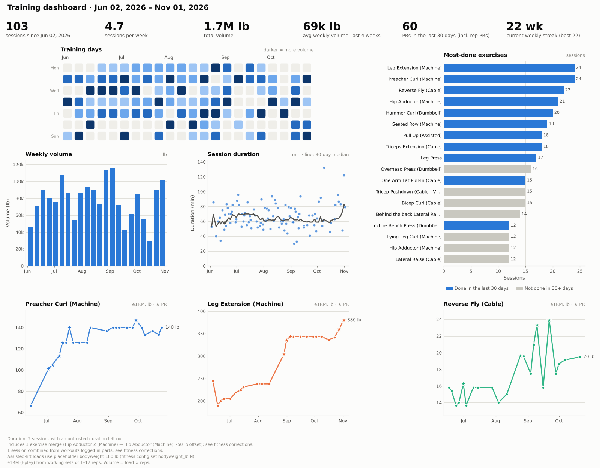
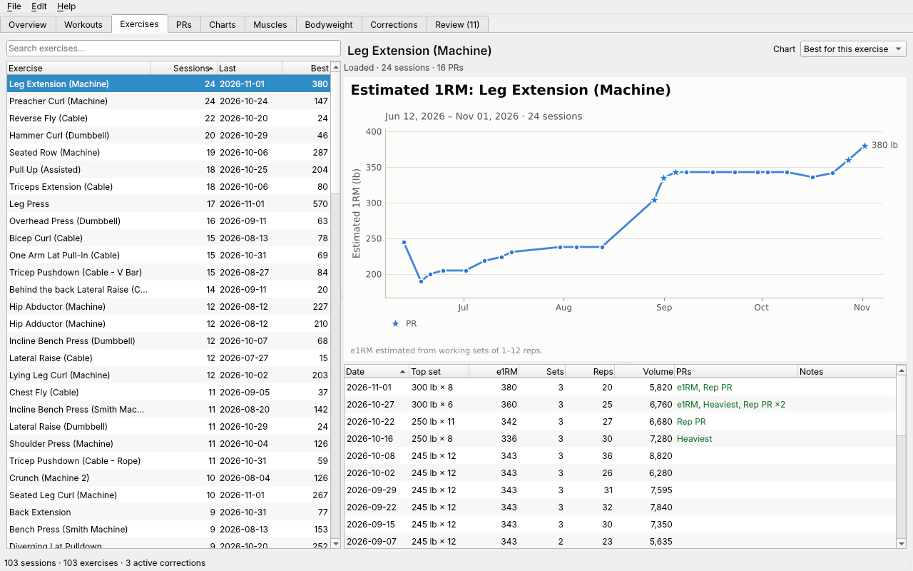

# User guide

This guide walks through using `fitness_aggregator` with your own Strong exports: install, first import, cleaning up the data, everyday commands, charts, and what to do when something looks wrong. The examples are real output from the export `weights_11_3_26.txt` (104 workouts, June to November 2026), trimmed to the useful parts.

Every command has `--help`, and that is the authority on options: `fitness --help`, `fitness prs --help`, `fitness plot progress --help`.

**Contents**

1. [Install](#1-install)
2. [Export from Strong](#2-export-from-strong)
3. [First import](#3-first-import)
4. [Review data-entry flags](#4-review-data-entry-flags-check--fix)
5. [Review similar exercises](#5-review-similar-exercises-merge-review)
6. [Corrections: see, undo, redo](#6-corrections-see-undo-redo)
7. [Daily use](#7-daily-use)
8. [Charts](#8-charts)
9. [Bodyweight from Apple Health](#9-bodyweight-from-apple-health)
10. [Desktop app](#10-desktop-app)
11. [Export, settings, files and backups](#11-export-settings-files-and-backups)
12. [Importing newer exports](#12-importing-newer-exports)
13. [Troubleshooting and FAQ](#13-troubleshooting-and-faq)

---

## 1. Install

You need Python 3.11 or newer. From the project folder:

```bash
python3 -m venv .venv
.venv/bin/pip install -e .            # the command-line tool, with charts
.venv/bin/pip install -e '.[gui]'     # optional: adds the desktop app (PySide6)
```

Then either activate the environment (`source .venv/bin/activate`) or call `.venv/bin/fitness` directly. The rest of this guide writes `fitness`.

> **Where config is found.** The settings file is `config/settings.toml` when you run from the project folder, otherwise `~/.fitness_aggregator/settings.toml`. The muscle map is found from any folder: `$FITNESS_AGGREGATOR_EXERCISES`, then `./config/exercises.toml`, then `~/.fitness_aggregator/exercises.toml`, then the project's own `config/exercises.toml`. See [§11](#11-export-settings-files-and-backups).

## 2. Export from Strong

In the Strong app, open **Settings** and use **Export Data** (the CSV export). The exact menu wording depends on the app version. Send the file to your computer by AirDrop, email or Files. The name doesn't matter: `weights_11_3_26.txt` imports the same as `strong.csv`.

Every Strong export holds your **entire** history, not just what's new since the last export. So you never need to keep old exports. Importing the newest one is always enough ([§12](#12-importing-newer-exports)).

The tool assumes weights are in **lb**.

## 3. First import

```console
$ fitness import weights_11_3_26.txt
Parsed 3,816 rows: 104 workouts, 1,962 sets (1,895 normal, 15 warm-up, 50 drop, 2 failure), 103 exercise names.
1,854 rest timers attached to sets.
First import: 104 workouts.
Imported. 104 workouts stored.
Corrections changed by this import:
  + #1 Duration 14h 7m excluded from duration stats: over 4h, probably a timer left running
  + #2 Duration 22h 43m excluded from duration stats: over 4h, probably a timer left running
  + #3 Merged 2026-06-02 14:06 workout into 2026-06-02 14:00 workout: started 3 min after it ended (threshold 60 min)
Corrections applied: 2 durations excluded, 1 workout merged. See fitness corrections.
3 sets flagged as possible data-entry errors. Review with fitness check.
11 groups of similar exercises to review (combine or keep separate): fitness merge review.
```

What each part means:

- **Parsed …**: what was in the file. Set types come from Strong's *Set Order* column: numbers are normal sets, `W` warm-ups, `D` drop sets, `F` sets to failure. Warm-ups are left out of PRs and volume by default.
- **Rest timers attached**: Strong writes each rest timer as its own row. They're attached to the set before them, so you can see rest times in `show` and averages in `exercises`.
- **Corrections changed by this import**: things the program adjusted automatically. Each has an ID, and every one can be undone ([§6](#6-corrections-see-undo-redo)). Two kinds happen automatically:
  - *Suspect durations*: a workout over 4 hours is almost certainly a timer left running. Its duration is left out of duration stats. Nothing else about the workout changes.
  - *Workout merges*: a workout that starts within 60 minutes of the previous one ending is counted as part of the same session. Here a 3-minute workout at 14:00 and a 47-minute one at 14:06 on 2026-06-02 became one session, which is why 104 workouts show as 103 sessions.
- **Flagged sets** and **similar exercises** change nothing until you review them. The next two sections cover both.

Your raw data is never edited. Corrections are stored separately and applied on top, so you can always see the original with `--raw`.

## 4. Review data-entry flags (`check` / `fix`)

`fitness check` goes through sets that look like typos. The rules:

- over 30 reps on a weighted set (with a swap suggested when the swapped weight fits your usual range);
- a working set over 2.5× your usual top set;
- weight with 0 reps on a normal or drop set (failure sets are exempt, since 0 reps is a missed attempt there).

```console
$ fitness check
(1/1) Preacher Curl (Machine) — Thu 2026-06-04 13:53 (Midday Workout)
   1  8 lb × 80  ⚠ 8 lb × 80: over 30 reps on a weighted set; your usual top set is about 100 lb
   2  8 lb × 60  ⚠ 8 lb × 60: over 30 reps on a weighted set; your usual top set is about 100 lb
   3  6 lb × 50  ⚠ 6 lb × 50: over 30 reps on a weighted set; your usual top set is about 100 lb
  Looks like weight and reps were swapped → 80 lb × 8, 60 lb × 8, 50 lb × 6
  [s] swap weight and reps  [e] edit  [i] not an error (dismiss)  [k] skip  [q] quit
```

- **`s` swap** or **`e` edit** records a `value_fix` correction.
- **`i` dismiss** means "this is right". The flag isn't raised again, and no correction is created. `fitness check --dismissed` lists what you've dismissed, and `fitness check --undismiss` raises those flags again.
- **`k` skip** leaves it for next time.

`fitness check --list` shows the flags without asking anything. To fix something no rule catches, use `fitness fix` directly. Name the workout by its start time (a date works if only one workout is on it), then the exercise:

```console
$ fitness fix 2026-06-04T13:53 "preacher curl" --swap-weight-reps
Recorded correction #4: Swapped weight and reps on 3 Preacher Curl (Machine) sets, 2026-06-04 13:53
(set 1: 8 lb × 80 → 80 lb × 8; set 2: 8 lb × 60 → 60 lb × 8; set 3: 6 lb × 50 → 50 lb × 6)
Undo with: fitness corrections revert 4
```

`--set 2` limits a fix to one set (use the label `fitness show` prints: `1`, `2`, `W`, `D`, `F`), and `--weight`, `--reps` and `--seconds` set values. Afterwards, `fitness show 2026-06-04` marks the corrected sets:

```
Preacher Curl (Machine)
1  80 lb  × 8 *  1m  was 8 lb × 80 (correction #4)
2  60 lb  × 8 *  1m  was 8 lb × 60 (correction #4)
3  50 lb  × 6 *  1m  was 6 lb × 50 (correction #4)
```

## 5. Review similar exercises (`merge review`)

Strong treats every name as a different exercise, so `Hip Abductor (Machine)` and `Hip Abductor 2 (Machine)` have separate histories and PRs. The program never combines exercises on its own. It finds candidates and asks you, because only you know whether two names are the same movement.

There are two tiers of candidates:

- **Likely the same**: names match apart from numbering, plurals, case or word order (`Crunch (Machine)` / `Crunch (Machine 2)`).
- **Possibly the same**: names are very similar but not identical (`Triceps Extension (Machine)` / `Real Tricep Extension (Machine)`). Pairs that differ by an opposite word, such as incline/decline or abductor/adductor, are never suggested.

The real example from this export: you switched gyms in August, and the second gym's abductor machine reads about 50 lb heavier for the same effort.

```console
$ fitness merge review
(2/11) Likely the same exercise (names match apart from numbering or plurals)
  [1] Hip Abductor (Machine)  12 sessions, 2026-06-02 → 2026-08-12, last top set 160 lb × 14 on 2026-08-12
  [2] Hip Abductor 2 (Machine)  9 sessions, 2026-08-22 → 2026-11-01, last top set 205 lb × 10 on 2026-11-01
  You switched from Hip Abductor (Machine) to Hip Abductor 2 (Machine) on 2026-08-22 (no overlap).
  Compared top sets:
    Hip Abductor (Machine): 2026-08-04 145 lb × 14, 2026-08-08 150 lb × 14, 2026-08-12 160 lb × 14
    Hip Abductor 2 (Machine): 2026-08-22 205 lb × 12, 2026-08-25 205 lb × 14, 2026-08-28 205 lb × 14
  Hip Abductor 2 (Machine) top sets were about 50 lb heavier at similar reps. Suggested: -50 lb on Hip Abductor 2 (Machine) (or ×0.75).
  [c] combine as-is  [o] combine with weight offset  [k] keep separate  [p] preview combined  [s] skip  [q] quit
>
```

- **`c` combine as-is**: count both names as one exercise. You pick which name to keep.
- **`o` combine with offset**: same, but adjust the other name's weights by a fixed amount (`-50`) or a factor (`x0.75`). It's a starting point: accept it or type your own. How it's worked out (the dated sets it used are always listed under "Compared top sets"):
  - **You switched machines** (no overlap, like Hip Abductor): your last 3 sessions on one are compared with your first 3 on the other, evening out rep differences.
  - **You used the other machine now and then** (like Leg Extension (Machine 2), used once on 2026-08-22 while you were using Leg Extension (Machine) before and after): each of those sessions is compared with your kept-machine sessions just before and after it, interpolating your e1RM to that date. Here that's 170 lb × 12 on 2026-08-12 and 240 lb × 8 on 2026-08-28, which put you at about 209 lb × 10 on 2026-08-22, against the 240 lb × 10 you did on Machine 2: suggested −30 lb. A session on the same day as the other machine is compared directly.
- **`k` keep separate**: they're different exercises. You won't be asked again.
- **`p` preview**: saves a chart of the sessions around the switch, as recorded and as adjusted (see `docs/images/plot_merge_preview.png`).
- **`s` skip** leaves it for later.

The same thing without prompts:

```console
$ fitness merge add "hip abductor 2" --into "hip abductor (machine)" --offset -50
Recorded correction #5: Hip Abductor 2 (Machine) combined into Hip Abductor (Machine) with -50 lb offset
Undo with: fitness merge undo "Hip Abductor 2 (Machine)"
```

The history then reads as one line of progress. Adjusted sessions are marked `†`, and they still show the recorded weight:

```console
$ fitness history "hip abductor"
...
2026-08-12    160 lb × 14              210     3    38   5,840  Rep PR
2026-08-22 †  155 lb × 12 (205 − 50)   217     2    24   3,660
2026-08-25 †  155 lb × 14 (205 − 50)   217     3    38   5,890
...
21 sessions; best e1RM 227 lb (170 × 10, 2026-06-02). e1RM: Epley, sets of 1–12 reps.
† recorded as Hip Abductor 2 (Machine), weights adjusted -50 lb (correction #5)
```

The old name keeps working: `fitness history "hip abductor 2"` shows the combined history. Other merge commands:

| Command | What it does |
|---|---|
| `fitness merge review --list` | List the candidates without asking |
| `fitness merge list` | What's combined (with offsets) and what you kept separate |
| `fitness merge add SOURCE --into NAME [--offset N \| --factor F]` | Combine without prompts |
| `fitness merge undo SOURCE` | Undo a combination |
| `fitness merge separate A B` | Record that two names are different exercises |
| `fitness merge forget A B` | Forget a keep-separate decision, so the pair is offered again |

New names that show up in later exports are offered for review automatically. The import summary says how many groups are waiting.

## 6. Corrections: see, undo, redo

Every change on top of your raw data, automatic or yours, is in one log:

```console
$ fitness corrections
ID  Type              Source  Status  Reason
 1  duration_suspect  auto    active  Duration 14h 7m excluded from duration stats: over 4h, probably a timer left running
 2  duration_suspect  auto    active  Duration 22h 43m excluded from duration stats: over 4h, probably a timer left running
 3  workout_merge     auto    active  Merged 2026-06-02 14:06 workout into 2026-06-02 14:00 workout: started 3 min after it ended (threshold 60 min)
 4  value_fix         user    active  Swapped weight and reps on 3 Preacher Curl (Machine) sets, 2026-06-04 13:53 (...)
 5  exercise_merge    user    active  Hip Abductor 2 (Machine) combined into Hip Abductor (Machine) with -50 lb offset
5 corrections. Undo one with: fitness corrections revert ID
```

- `fitness corrections revert 3` undoes one; `fitness corrections restore 3` re-applies it. An automatic correction you revert stays reverted on later imports.
- Shortcuts: `fitness workouts unmerge 2026-06-02T14:06` reverts a workout merge, and `fitness merge undo NAME` reverts a combination.
- Filter with `--type`, `--auto`, `--user`, `--exercise`, `--since` or `--status`. `--all` also lists obsolete entries.
- Most read commands take **`--raw`** to ignore every correction, so you can compare: `fitness show 2026-06-04 --raw` shows the original `8 lb × 80`.

Statuses:

| Status | Meaning |
|---|---|
| `active` | Applied to your data |
| `reverted` | You undid it. Not applied, and not re-created automatically |
| `obsolete` | An automatic correction that no longer applies, for example because you changed a setting or deleted the workout in Strong. Hidden unless you pass `--all` |
| `stale` | A correction you made whose target changed in a newer export (say you fixed the typo in Strong too). It's reported on import and not applied. Make a new fix if one is still needed |

## 7. Daily use

| Command | Shows |
|---|---|
| `fitness workouts` | Recent sessions (`--all`, `--since DATE`, `-n N`) |
| `fitness show [last\|DATE\|START]` | One session set by set, with rest times and any corrections |
| `fitness history EXERCISE` | One lift session by session: top set, e1RM, sets, reps, volume, PRs |
| `fitness prs` | Current bests for every exercise (`--sort e1rm`) |
| `fitness prs EXERCISE` | Best load at each rep count, plus the PR timeline for one lift |
| `fitness prs --recent 30d` | PRs set in a window (`4w`, `3m` also work) |
| `fitness stats` | Frequency, streaks, gaps and weekly volume (`--by month`) |
| `fitness muscles` | Hard sets per muscle per week, against a 10–20 target |
| `fitness exercises` | Everything you've logged (`--sort recent`, `--search curl`, `--unmapped`) |

Exercise names can be shortened to any unique part, ignoring case. If the part matches several exercises, the command lists them and asks you to be more specific:

```console
$ fitness history curl
Error: 'curl' matches 14 exercises (Bicep Curl (Barbell), Bicep Curl (Cable), Bicep Curl (Dual Cable), …); be more specific.
```

```console
$ fitness workouts -n 3
Date                  Name    Duration  Exercises  Sets
Thu 2026-10-29 23:04  Push 1       48m          5    16
Sat 2026-10-31 18:48  Pull 1     2h 2m         10    30
Sun 2026-11-01 19:23  Legs      1h 19m          6    19
```

```console
$ fitness stats -n 2
103 sessions from Tue 2026-06-02 14:00 to Sun 2026-11-01 19:23  ·  4.7 per week  ·  1.5 days between sessions on average
Longest gap: 7 days (2026-10-08 → 2026-10-15)  ·  Last session 4 days ago  ·  Weekly streak: 22 (longest 22)
Totals: 1,719,363 lb volume, 1,947 sets, 18,912 reps, 470 PRs

Week of     Sessions    Time     Avg  Sets  Reps  Volume (lb)  PRs
2026-10-19         5  5h 28m  1h 22m    99   923       89,925   23
2026-10-26         4  5h 32m  1h 23m    81   779      100,977   25
```

```console
$ fitness prs "leg extension (machine)"
...
PR timeline
Date        PR        Set             New  Previous
2026-10-27  e1RM      300 lb × 6   360 lb    343 lb
2026-10-27  Heaviest  300 lb × 6   300 lb    250 lb
2026-11-01  e1RM      300 lb × 8   380 lb    360 lb
```

How the numbers work:

- **e1RM** (estimated one-rep max) uses Epley by default, or Brzycki with `--formula brzycki`. Sets over 12 reps don't count toward e1RM, because the estimate gets unreliable.
- **Warm-ups** are excluded from PRs always, and from volume and set counts unless you pass `--include-warmups`.
- **Assisted lifts** (Pull Up (Assisted), Chest Dip (Assisted)): Strong records the assistance, so the effective load is bodyweight − assistance. Until you import bodyweight, a placeholder of 180 lb is used, and output says so.
- **Timed holds** (Plank) are tracked by seconds, and **bodyweight moves** (Decline Sit-ups) by reps.

### Muscle groups

`fitness muscles` counts hard sets (normal, drop and failure sets) per muscle. Each set counts 1 for the exercise's primary muscles and 0.5 for its secondary ones. Weeks under 10 or over 20 sets are highlighted.

```console
$ fitness muscles -n 3
Muscle       10-12  10-19  10-26   Avg
chest            6     19      9  11.3
biceps           6     21      6  11.0
lats             0     21      9  10.0
quads            6      9     12   9.0
...
```

The mapping lives in `config/exercises.toml`, one entry per exercise name:

```toml
[exercise."Bench Press (Barbell)"]
primary = ["chest"]
secondary = ["triceps", "front_delts"]
```

When you start a new exercise in Strong, `fitness exercises --unmapped` lists it with a keyword guess. Guesses are used in the meantime and are marked as guesses (shown with a `?`). Add an entry to the file to make it permanent.

## 8. Charts

Every `fitness plot …` command saves a PNG in `./plots/` and prints the path. `--out FILE` picks the name and format (`.png`, `.svg` or `.pdf`), and `--show` opens a window instead, if you have a display.

```bash
fitness plot progress "hip abductor (machine)" --trend   # e1RM over time, PRs starred, 30-day trend
fitness plot progress "squat (barbell)" "leg press" --split   # several lifts, one panel each
fitness plot progress "pull up" --metric assistance # assistance only, lower is better
fitness plot volume --by month                      # bars stacked by workout name
fitness plot calendar                               # training days, darker = more volume
fitness plot duration                               # session length (runaway timers left out)
fitness plot frequency --top 15                     # sessions per exercise; neglected lifts greyed
fitness plot rep-prs "leg extension (machine)"      # best load at 1–15 reps, now vs a month ago
fitness plot dashboard --out summary.pdf            # one-page summary
```

There is also a chart of weekly hard sets per muscle, drawn against the 10–20 target band: `fitness plot sets-per-muscle` (pick muscles with `-m chest -m lats`, use `--heatmap` for every muscle at once, `--by month` for average sets per week in each month, or `--target none`). The week still in progress is left out. Run `fitness plot --help` for the full list and each chart's options.

Charts built from corrected data say so in a footnote, for example when they include a combined exercise or use the placeholder bodyweight.



More samples from this export: [progress](images/plot_progress.png), [weekly volume](images/plot_volume.png), [rep maxes](images/plot_rep_prs.png), [training calendar](images/plot_calendar.png), [merge preview](images/plot_merge_preview.png).

## 9. Bodyweight from Apple Health

Bodyweight matters only for assisted lifts. To use your real weight instead of the 180 lb placeholder:

1. On your iPhone, open the Health app, tap your profile picture, and choose **Export All Health Data**. This makes `export.zip`, which can be large.
2. Import it. The zip or the `export.xml` inside it both work.

```bash
fitness import-health export.zip
fitness bodyweight              # recent entries, lowest/highest, 30- and 90-day change
```

Readings in kg or stones are converted to lb, several readings on one day are averaged, and implausible values are skipped and reported. Each assisted-lift set then uses the latest weight on or before that workout. Like Strong exports, each Health export is your full history and replaces the stored entries.

If you never import Health data, set the placeholder to something close: `fitness config set bodyweight_lb 175`.

## 10. Desktop app

If you installed the `gui` extra:

```bash
fitness gui                  # or: fitness-gui
```

It reads the same database and settings as the command line and draws the same charts. Tabs:

- **Overview**: headline stats, recent PRs, and how many flags and similar-exercise groups are waiting.
- **Workouts**: sessions, with each one's sets and the corrections applied to it.
- **Exercises**: searchable list; history table and progress chart (pick the metric).
- **PRs**: current bests and the last 30 days' PRs.
- **Charts**: any of the `fitness plot` charts, with **Save as…** (PNG, SVG, PDF).
- **Muscles**: weekly hard sets per muscle (under 10 amber, over 20 purple) and the chart.
- **Bodyweight**: stored Apple Health entries and a chart.
- **Corrections**: the log, with Revert and Restore.
- **Review**: data-entry flags (swap, edit, dismiss) and similar exercises (combine, with an editable suggested offset, or keep separate).

**File → Import Strong export…** and **Import Apple Health export…** show what will change before importing. Shortcuts: Ctrl+I import, F5 refresh, Ctrl+F find an exercise, Ctrl+S save the current chart. Data reloads in the background, so the window stays responsive. An empty database shows a welcome screen explaining how to import.



`fitness --db other.db gui` opens a different database, and so does `fitness-gui --db other.db`.

## 11. Export, settings, files and backups

### Export

```bash
fitness export > sets.csv                            # every set, corrections applied
fitness export --what sessions --format json -o sessions.json
fitness export --what prs --since 2026-09-01
fitness export --what corrections                    # the corrections log itself
```

`--what` is one of `sets`, `sessions`, `exercises`, `prs` or `corrections`. `--raw` exports without corrections. See `fitness export --help` for what each export contains.

### Settings

```console
$ fitness config show
Settings file: /home/you/fitness_aggregator/config/settings.toml
  bodyweight_lb = 180
  merge_gap_minutes = 60
  suspect_duration_hours = 4
```

| Setting | Default | What it does |
|---|---|---|
| `bodyweight_lb` | 180 | Placeholder bodyweight for assisted lifts, until Health data is imported |
| `merge_gap_minutes` | 60 | Merge a workout into the previous one if it starts within this many minutes of that one ending |
| `suspect_duration_hours` | 4 | Durations longer than this are treated as a timer left running |

`fitness config set KEY VALUE` changes a setting and immediately recomputes the automatic corrections, showing what changed. You can also edit the file by hand.

### Where your data lives

| What | Where |
|---|---|
| Database: workouts, corrections, merge decisions, dismissed flags, bodyweight | `~/.fitness_aggregator/lifts.db`. Override with `--db PATH` or `$FITNESS_AGGREGATOR_DB` |
| Settings | `--config PATH`, else `$FITNESS_AGGREGATOR_CONFIG`, else `./config/settings.toml` if it exists, else `~/.fitness_aggregator/settings.toml` |
| Muscle map | `./config/exercises.toml`, in the folder you run from |
| Charts | `./plots/`, unless you pass `--out` |

### Backups

Your workouts can always be re-imported from the latest Strong export. What can't be recreated is **your decisions**: fixes, combinations, keep-separate choices and dismissed flags. They all live in `lifts.db`, so back up that one file. Copy it while no `fitness` command or the app is running:

```bash
cp ~/.fitness_aggregator/lifts.db ~/backups/lifts-$(date +%F).db
```

To try something without risk, work on a copy: `fitness --db /tmp/test.db import weights.txt`.

## 12. Importing newer exports

Export from Strong whenever you like and import the new file:

```console
$ fitness import weights_11_3_26.txt
Parsed 3,816 rows: 104 workouts, 1,962 sets (1,895 normal, 15 warm-up, 50 drop, 2 failure), 103 exercise names.
1,854 rest timers attached to sets.
Changes since last import: 1 new, 1 edited, 0 removed, 102 unchanged.
  new     Sun 2026-11-01 19:23  Legs
  edited  Sat 2026-10-31 18:48  Pull 1: set values changed
Imported. 104 workouts stored.
Corrections applied: 2 durations excluded, 1 workout merged. See fitness corrections.
```

(Here the previous import was an earlier export, before the 2026-11-01 workout and before one set on 2026-10-31 was edited in Strong.)

- **Replace, not append.** The new export replaces the stored workouts. Your corrections and decisions are kept and re-applied, because they point at workout start times and exercise names rather than internal IDs.
- **Edited workouts** (sets you changed in Strong) are listed. If a change affects something you fixed, that correction is marked `stale` and reported.
- **Deleted workouts** are listed and need confirming before they're dropped (`--yes` skips the question).
- **Re-importing the same file** changes nothing and says so.
- **An older export is refused**, because importing it would look like your recent workouts had been deleted. `--force` overrides this.

## 13. Troubleshooting and FAQ

**Why is my 3-minute workout merged into the next one?**
Workouts that start within 60 minutes of the previous one ending count as one session. This catches the common case of starting a workout, stopping, and starting again. The 2026-06-02 sessions at 14:00 (3 min) and 14:06 are an example. To split one back out: `fitness workouts unmerge 2026-06-02T14:06`. To change the rule: `fitness config set merge_gap_minutes 30`. Workouts with a runaway timer don't use their recorded end time for this, so a 14-hour timer won't swallow the next morning's workout.

**Why don't my old exports import?**
Two possible reasons:
- *"this export's latest workout … is older than what's already stored"*: you've already imported a newer export. Since every export is your full history, the newer one already contains everything in the old one, so there's nothing to gain. Use `--force` only if you really want to go back.
- *"not a Strong export: missing column(s) …"*: the file doesn't have Strong's CSV columns (`Date, Workout Name, Duration, Exercise Name, Set Order, Weight, Reps, Distance, Seconds, Notes, Workout Notes, RPE`). Check you exported the CSV and not another format.

**How do I undo …**

| … this? | Run |
|---|---|
| any correction | `fitness corrections` to find its ID, then `fitness corrections revert ID` |
| an automatic workout merge | `fitness workouts unmerge START_TIME` |
| a set fix | `fitness corrections revert ID` (the ID is printed when you make the fix) |
| combining two exercises | `fitness merge undo "NAME THAT WAS COMBINED AWAY"` |
| a "keep separate" decision | `fitness merge forget A B` |
| a revert | `fitness corrections restore ID` |
| dismissing a flag | `fitness check --undismiss` raises every dismissed flag again (`fitness check --dismissed` lists them first) |

**A workout's duration shows in (parentheses).** It's over the suspect-duration limit (4 hours by default), so it's left out of duration stats. Revert that `duration_suspect` correction if the workout really was that long.

**`fitness muscles` shows guesses, or wrong muscles.** The exercise is probably new, so it has no entry in `config/exercises.toml` yet. `fitness exercises --unmapped` lists these with a snippet to paste into the file.

**My PRs look too high or too low.** Look for a typo with `fitness check`, or check whether two exercises are combined with an offset (`fitness merge list`). Compare against `--raw` to see the numbers without any corrections.

**Pull-up loads look odd.** Assisted lifts use bodyweight − assistance, and the placeholder is 180 lb until you import Apple Health data ([§9](#9-bodyweight-from-apple-health)). `fitness plot progress "pull up" --metric assistance` shows the assistance alone.

**My Strong app is set to kg.** The tool treats every weight as lb, and there's no kg option yet.

**"… is not a fitness_aggregator database, or it is damaged"**: the file given with `--db` or `$FITNESS_AGGREGATOR_DB` isn't one of this tool's databases. A database made by a newer version is refused too. Point `--db` at the right file, or restore a backup.

**"this export's latest workout … is older than what's already stored"**: see "Why don't my old exports import?" above.

**The desktop app won't start.** `fitness gui` says what's missing. Usually it needs `pip install -e '.[gui]'`.
